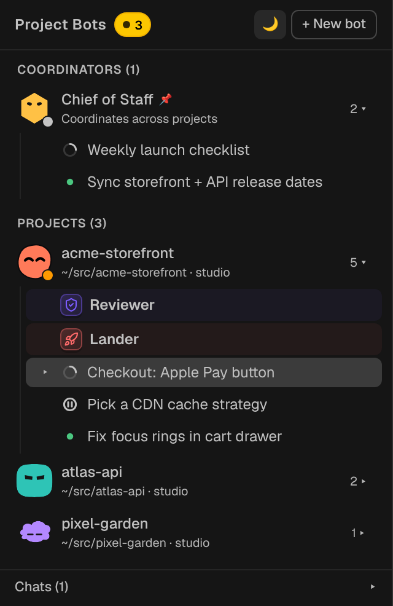
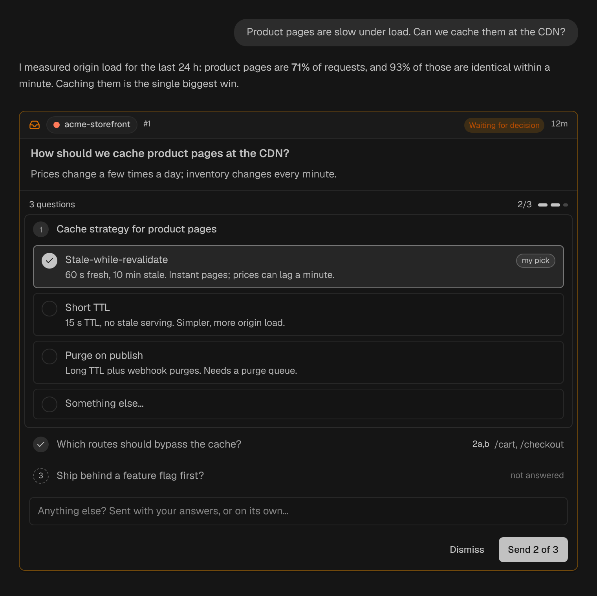
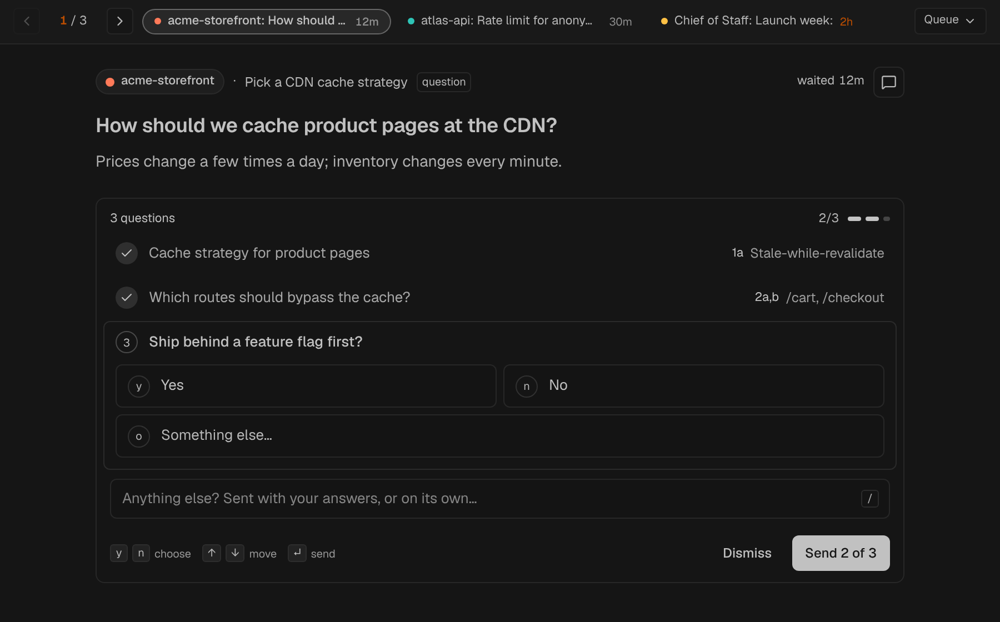
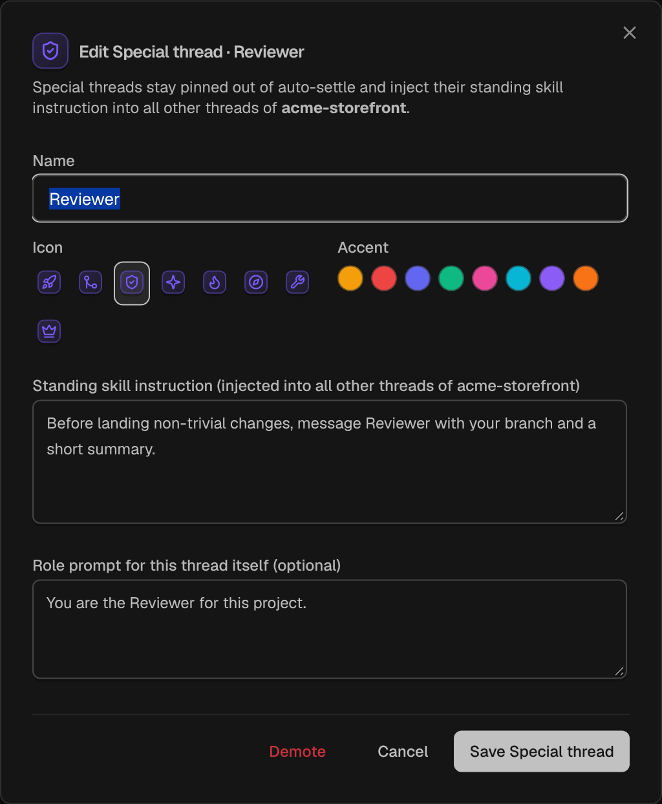

# bb-project-bots

A BB plugin that gives every project its own bot, adds coordinator bots that work across projects, and gives agents one tool for talking to you and to each other: `message()`. Questions go to an **Inbox** where you answer them with interactive cards, either in the thread or from a single queue.

<p align="center">
  
</p>

## What you get

| | |
|---|---|
| **Project Bots** | One bot per BB project, with its own avatar, identity (SOUL) and durable memory. |
| **Coordinator bots** | Bots that aren't tied to a project. They delegate to project bots instead of editing code. |
| **`message()`** | One tool for prose to the user, decision questions, and bot-to-bot or thread-to-thread messages. |
| **Inbox** | A queue of open questions from every bot, plus inline answer cards in each thread. |
| **Special threads** | Promote a thread to a named role (Reviewer, Lander, …) that its sibling threads know how to reach. |
| **Dream Mode** | Background memory consolidation for each bot. |
| **Lifecycle** | Idle threads settle automatically. Optional auto-archive and auto-delete. |

## Asking you questions: `message()` and the Inbox

Agents use one tool for all communication:

```ts
message({ text, to?, query? })
```

- **`to` omitted (or `"user"`) with no `query`**: `text` renders as normal chat prose. Nothing goes to the Inbox.
- **`to` omitted with a `query`**: the message becomes a **decision card**. The card renders inline in the thread and is also queued in the Inbox. The sidebar badge counts open items, and threads that are waiting on you show *waits on you* in BB's thread list.
- **`to: "<bot id | project id | bot name>"`, `"thr_…"`, `"parent"`, or a Special thread name**: an asynchronous message to another bot or thread. Delivery is attributed to the sender and queued if the target is busy.

The tool returns a `previewDirective` (`::inbox-message{id="…"}`). The agent copies it into its reply, and BB renders the prose or the card at that spot.

### Inline decision cards

<p align="center">
  
</p>

A `query` holds one or more questions. Each has one of these kinds:

| `kind` | Renders as | Notes |
|---|---|---|
| `choice` | One option | 2+ options with `label`, optional `key` (`a`–`z`), `detail`, `preview` (Markdown), `recommended` |
| `multi` | Any number of options | Same option fields as `choice` |
| `confirm` | Yes / No | |
| `text` | Free text | Optional `placeholder` |
| `scale` | A min–max scale | `scale: { min, max, low?, high? }`, at most 10 steps |

How the card behaves:

- **Recommended options** are pre-selected and marked *my pick*, so you can send a sensible default immediately.
- **One question at a time.** Questions open accordion-style with progress pills. Answered questions collapse to their answer (`1a Stale-while-revalidate`). Single-select questions advance on their own.
- **Escape hatches.** Every `choice`/`multi` question gets *Something else…*, and the card has a free-text note field. Agents must not add their own "Other" option. The server rejects it.
- **Undo.** *Send* gives you a 3-second undo window. Hold the button for one second to skip the window.
- **Reply format.** Answers go back to the thread as one compact reply, e.g. `1a. Cache strategy for product pages: Stale-while-revalidate`, plus your note. The agent continues from there.

### The Inbox panel

<p align="center">
  
</p>

The **Inbox** nav panel (also reachable from the yellow sidebar badge or the command *Inbox: Open Inbox*) shows every open question from every bot:

- A single-row **queue switcher** across bots, with ages. Long waits are highlighted.
- **Keyboard first:** `1–9` / `a–z` choose, `y` / `n` answer confirms, `o` opens *Something else*, `↑ ↓` move between questions, `Enter` sends, `/` jumps to the note, `Esc` backs out.
- **Instant:** cached-first loading, with optimistic answer and dismiss that move straight to the next item.
- Drafts are saved per message, so you can leave and come back.
- *Resolved today* keeps a short history.

## Bots

### Project Bots (one per project)

- Every standard BB project gets a bot automatically. It shows a deterministic generated avatar. When the project spans hosts, a host pill appears in front of the name.
- The first time you open a thread in the project, the bot's file is created at `~/.bb/project-bots/<sha256(projectPath)[0:6]>.md`.
  - Frontmatter stores appearance (`color`, `shape`, `expression`, `motion`), `name`, `role`, `soul`, `projectId` and `projectPath`.
  - The body is durable memory (`## Facts`, `## Lessons`, `## Preferences`), managed with the `update_memory_state` tool (`fact`, `lesson`, `preference`, `add`, `append`, `forget`, `replace`, `read`).
  - Memory entries carry `[date | confidence]` tags. Stale entries are flagged so agents verify them against the code before relying on them.

### Coordinator bots

- Not tied to any project. Each one lives in `~/.bb/project-bots/unaffiliated/<botId>/bot.md`.
- Coordinate only: they don't edit repositories. They find other bots and delegate to them with `list_bots`, `inspect_bot` and `message({ to, text })`.

### Sidebar

- Bots are pinned first, then sorted by most recent activity.
- Conversations nest under their bot, with animated status icons: working, waiting for input, error, unread or read.
- Drag a thread to reorder it, or use *Move to top / up / down* in its context menu. New conversations always appear above your saved order.
- **Personal chats** sit in a collapsible *Chats* section at the bottom.

## Special threads

<p align="center">
  
</p>

Promote any thread of a bot to a named role, or start a new one from the bot's **+** button. Presets: **Reviewer**, **Lander**, **Deployer**, **Design Reviewer**, **Critic**.

- **Standing instruction.** Added to the system prompt of every *other* thread of that bot, e.g. *"Before landing non-trivial changes, message Reviewer with your branch and a summary."*
- **Role prompt.** Added only to the Special thread itself.
- **Routing by name.** `message({ to: "Reviewer", text })` reaches the right thread. Names are unique per bot (case-insensitive). If a name also matches a bot, the call returns an error instead of guessing.
- Special threads stay at the top of the bot's list with a colored icon and never auto-settle.
  - Archiving one demotes it.
  - Promoting never renames the underlying BB thread.

## Dream Mode

Dream Mode periodically consolidates each bot's recent conversations into its memory:

- It runs as **one visible `🌙 Dream Mode` thread** under the top coordinator. It resets its context between bots and keeps the transcript.
- Configure it with the moon button in the sidebar header (provider, model, interval).
- Run it on demand with `bb project-bots dream <bot>`.

## Lifecycle settings

These live in **Settings → Plugins → Project Bots**:

| Setting | Default |
|---|---|
| Auto-settle idle threads (never the most recent thread per bot) | On, 72 h |
| Auto-archive settled threads | Off, 7 days |
| Auto-delete archived threads | Off, 30 days |
| Auto-settle idle project bots | Off, 168 h |
| Auto-delete projects with no active threads (bot files stay on disk) | Off, 30 days |

Settled threads collect behind a small *N settled ▸* toggle under each bot.

## Agent tools

| Tool | Purpose |
|---|---|
| `message` | User prose, Inbox decisions, and bot or thread messaging |
| `update_memory_state` | Read and edit the bot's memory |
| `list_bots` | Discover project bots and coordinator bots |
| `inspect_bot` | See another bot's recent threads, turns and queued messages |

## CLI

```bash
bb project-bots list [--json]
bb project-bots inspect <bot-id-or-name> [--json]
bb project-bots message <bot-id-or-name> "<message>" [--thread <id>] [--new-thread] [--json]
bb project-bots dream <bot-id-or-name> [--force] [--json]
```

## Development

```bash
npm run typecheck
npm test
bb plugin build
bb plugin reload bb-project-bots
```

### Screenshots

Screenshots are rendered from **synthetic fixtures** in [`scripts/screenshots/fixtures.ts`](scripts/screenshots/fixtures.ts) through the SDK's test runtime. They use the real plugin components and CSS, with BB's theme. Never capture live sidebars or conversations. To regenerate them:

```bash
bb plugin build
node scripts/screenshots/capture.mjs   # writes docs/screenshots/*.png
```

The script finds BB's app stylesheet under `~/bb/app` automatically. Override it with `BB_HOST_CSS=…`, and the browser with `CHROME=…`.
